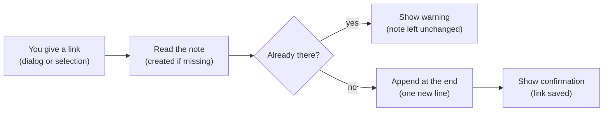

# Link Keeper — Obsidian plugin specification

## Overview

Link Keeper is an Obsidian plugin that adds a link to a note only if that note does not already contain it. If the link is already there, the plugin tells the user and changes nothing.

**Problem it solves:** when you collect links in one note (reading list, resources, bookmarks), it is easy to paste the same link twice. Checking by hand means searching the note every time.

**Scope:**

- One configurable target note collects links (default `Links.md`).
- The same check can run against the currently open note.
- Works with web links (`https://…`) and Obsidian note links (`[[Note]]`).
- A separate command sorts each block of link lines in the open note (see “Sorting links”).
- Works on desktop and mobile Obsidian, version 1.4.0 or newer.

## How it works



Every add follows the same five steps:

1. The user runs a command and gives a link — typed, pasted, pre-filled from the clipboard, or selected in the editor.
2. The plugin picks the note: the target note from settings, or the open note for “Add link to current note”. If the note does not exist, it is created empty.
3. The plugin reads the whole note and looks for the link, using the duplicate rules below.
4. **Found:** a warning pop-up says the link is already there. The note is not touched.
5. **Not found:** one new line with the link is added at the end of the note, and a confirmation pop-up appears.

## Commands and entry points

The plugin has four commands (Command palette, Ctrl/Cmd+P) and a sidebar icon. Three commands and the icon start the add flow above; “Sort links in current note” sorts each block of link lines in the open note (see “Sorting links” below). Each command can be given a hotkey in Settings → Hotkeys.

| Entry point | Where the link comes from | Note it checks and writes to | Available when |
| --- | --- | --- | --- |
| Add link to target note | Typed or pasted into a dialog | Target note from settings | Always |
| Add link to current note | Typed or pasted into a dialog | The note open right now | A Markdown note is open |
| Add selected link to target note | Text selected in the editor | Target note from settings | Text is selected |
| Sort links in current note | No link is given: it sorts each block of link lines already in the note | The note open in the editor | A Markdown note is open in the editor |
| Ribbon icon (link symbol) | Typed or pasted into a dialog | Target note from settings | Always |

**The dialog:**

- One text field with placeholder `https://… or [[Note]]` and an **Add** button.
- If “Pre-fill from clipboard” is on and the clipboard holds a web address, the field starts filled with it, text selected.
- Enter submits. Esc closes without doing anything.
- An empty field submits nothing.

## Duplicate detection rules

A link counts as a duplicate if it appears anywhere in the note — in a list, inside a sentence, in a Markdown link `[title](url)`, or in brackets. The check reads the whole note every time.

**Web links (input starts with `http://` or `https://`)**

Every web address in the note is found, then both sides are normalized before comparing:

1. `http` and `https` are treated as the same.
2. The domain is compared without capital letters, and a leading `www.` is ignored.
   The port must match (`:8080`); a default port (`:80`, `:443`) can be left out.
3. Trailing slashes on the path are ignored.
4. Punctuation stuck to the end in a sentence (`. , ; : ! ?`) is ignored.
5. The path, query (`?x=1`) and anchor (`#part`) must match exactly, including capital letters.

| Input | Already in the note | Result |
| --- | --- | --- |
| `https://example.com/page` | `https://www.Example.com/page/` | Duplicate |
| `http://example.com/page/` | `https://example.com/page` | Duplicate |
| `https://foo.dev/a?x=1` | `see (https://foo.dev/a?x=1).` | Duplicate |
| `https://foo.dev/a?x=2` | `https://foo.dev/a?x=1` | New, added |
| `https://example.com/Page` | `https://example.com/page` | New, added |
| `https://example.com:8080/page` | `https://example.com/page` | New, added |
| `https://en.wikipedia.org/wiki/Mercury_(planet)` | `[Mercury](https://en.wikipedia.org/wiki/Mercury_(planet))` | Duplicate |

**Anything else (`[[Note]]`, plain text)**

The note is searched for the exact text, ignoring capital letters. `[[My Note]]` is a duplicate of `[[my note]]`, but `[[My Note]]` and `[[My Note|alias]]` are different.

## Appending rules and notifications

A new link always goes on its own line at the very end of the note. Nothing else in the note moves or changes.

**How the line is written**

1. The line comes from the “Line format” setting, with `{link}` replaced by the link. Default: `- {link}` → `- https://example.com`. A format without `{link}` is ignored and the default is used, so the link is never lost.
2. If the note does not end with a line break, one is added first, so the link never joins the last line.
3. The new line ends with a line break, ready for the next link.
4. The link is written exactly as the user entered it — not normalized.
5. If the note is empty, the link becomes its first line.

**Messages shown to the user** (small pop-up in the top-right corner)

| Situation | Message | Shown for | Note changed? |
| --- | --- | --- | --- |
| Link is new | ✅ Added to “Links”: *link* | 4 seconds | Yes, one line added |
| Link already in the note | ⚠️ Already in “Links”: *link* | 6 seconds | No |
| Something failed | Link Keeper: could not add the link — see the developer console. | Default | No |

## Sorting links

“Sort links in current note” reads the note open in the editor from top to bottom and sorts each block of link lines on its own. Every other line stays where it is. It is a separate command: adding a link never sorts, and a new link still goes at the end of the note.

**Rules**

1. **Link line:** a line with one web link and nothing else. In this order:
   - optional spaces or tabs;
   - an optional list marker (`-`, `*`, `+`, or a number with `.` or `)`), then one or more spaces or tabs;
   - only after a list marker: an optional task box (`[ ]`, `[x]`, `[X]`), then one or more spaces or tabs;
   - exactly one web link (`http://` or `https://`; capital letters count, as in `HTTPS://`);
   - nothing else, apart from spaces or tabs at the end.

   | Line | Link line? |
   | --- | --- |
   | `https://github.com/dekey/link-keeper` | yes |
   | `- https://github.com/dekey/link-keeper/pull/2` | yes |
   | `12. https://a.com/x` | yes |
   | `+ https://a.com/x` | yes |
   | a tab, then `- [ ]  https://a.com/x` | yes (indent, task box, two spaces) |
   | `- [X] https://a.com/x` | yes |
   | `-   https://a.com/x` | yes (several spaces after the marker) |
   | `-`, a tab, then `https://a.com/x` | yes (a tab after the marker) |
   | `HTTPS://A.COM/x` | yes (capital letters) |
   | `-https://a.com/x` | no (no space after the marker) |
   | `*https://a.com/x*` | no (no space after the `*`: italic text) |
   | `- [ ]https://a.com/x` | no (no space after the task box) |
   | `See https://a.com/x` | no (text before) |
   | `- https://a.com/x nice` | no (text after) |
   | `- https://a.com/x https://b.com/y` | no (two links) |
   | `- [title](https://a.com/x)` | no (Markdown link) |
   | `- [[Note]]` | no (note link) |
   | `> https://a.com/x`, `# https://a.com/x` | no (quote, heading) |
   | `- 2. https://a.com/x` | no (two list markers) |
   | `[ ] https://a.com/x` | no (task box without a list marker) |
   | `- [-] https://a.com/x` | no (only `[ ]`, `[x]`, `[X]` count as a task box) |
   | `- <https://a.com/x>` | no (link in angle brackets) |

2. **Block:** one or more link lines right under each other. Any other line ends a block: a blank line, text, a heading, a line with a link and text. A block also ends where a line with a list marker follows a line without one, or the other way round (`https://a.com/z` then `- https://a.com/a` are two blocks). So a task box never lands on a line without a list marker.
3. **Sort:** each block on its own, by the sort key of its link (see “Sort key” and “Order” below). Lines with the same key keep their old order, so sorting a second time changes nothing.
4. **What moves:** each place keeps its start (the spaces or tabs and the list marker with the spaces after it) and its end (spaces or tabs at the line end, so a line break made with two spaces stays on its line). Only the task box and the link move. So a numbered list keeps its numbers 1, 2, 3, a bullet stays a bullet, each indent stays, and a task box moves with its link. Each line keeps its own line break, so Windows line breaks (CRLF) and a missing line break at the end stay as they were; an invisible byte order mark stays at the very start. The sort does not remove duplicates and does not change the text that moves.
5. **Never touched:**
   - the frontmatter, as Obsidian reads it: a `---` first line up to the next line that is exactly `---` (a `...` line does not end it). A `---` first line with no closing `---` is not frontmatter: it is a normal line, and the link lines below it are sorted;
   - fenced code blocks: from a line that starts with 3 or more `` ` `` or `~` (after optional spaces or tabs and list markers, as in ```` - ``` ```` and ```` - 1. ``` ````) to a line with only the same character, at least as many (spaces or tabs before or after them are fine; other blank-looking characters, such as a no-break space, are not). A backtick fence has no backtick after it on the same line, so ```` ```a``` text ```` is inline code, not a fence. A code block that is never closed runs to the end of the note.

   Lines inside them are not link lines and end a block.
6. **Count:** *n* in “✅ Sorted *n* links” is the number of all link lines in the note: also blocks of one line and lines that did not move.

**Example**

| Before | After |
| --- | --- |
| `# Reading` | `# Reading` |
| `- https://b.com/zeta` | `- https://a.com/2-intro` |
| `- https://a.com/2-intro` | `- https://b.com/zeta` |
| `Some text` | `Some text` |
| `1. https://github.com/dekey/link-keeper` | `1. [ ] https://github.com/dekey/link-keeper/pull/2` |
| `2. [ ] https://github.com/dekey/link-keeper/pull/2` | `2. https://github.com/dekey/link-keeper` |

`Some text` splits the note into two blocks, and each is sorted on its own. The numbers 1 and 2 stay; the task box moves with its link. The key `2` comes before `link-keeper`. The pop-up says “✅ Sorted 4 links”.

**Sort key**

The key is the text after the last `/` of the link, without the query (`?…`) and the anchor (`#…`), and then without the slashes and punctuation (`. , ; : !`) at its end, so `https://a.com/docs.?x=1` is sorted by `docs`. `%` codes are turned back into letters. If the key has a broken one (as in `100%`), no code in it is turned back: the key stays as it is. A link with no path is sorted by its domain, `www.` included.

| Link | Sorted by |
| --- | --- |
| `https://github.com/dekey/link-keeper/pull/2` | `2` |
| `https://github.com/dekey/link-keeper` | `link-keeper` |
| `https://a.com/docs/page?id=2` | `page` |
| `https://a.com/docs/` | `docs` |
| `https://www.a.com/` | `www.a.com` |
| `https://en.wikipedia.org/wiki/Mercury_(planet)` | `Mercury_(planet)` |
| `https://ru.wikipedia.org/wiki/%D0%9C%D0%BE%D1%81%D0%BA%D0%B2%D0%B0` | `Москва` |

**Order**

Punctuation first, then digits, then letters. Numbers are compared by value, so `2-tips` comes before `10-tips`. Capital letters and accents do not count (`alpha` = `Alpha`, `éclair` = `eclair`). Other scripts, like Cyrillic, come after Latin letters.

**Writing and messages**

The command changes only the lines that change, in one step through the open editor (Obsidian saves it as usual), so Ctrl/Cmd+Z undoes the whole sort at once and the rest of the note (folded sections) is not touched. The sort is its own undo step: Ctrl/Cmd+Z right after it undoes only the sort, not typing done just before it. It writes only when the order changes. The cursor stays on the same line number; that line may now hold another link, and when that line is shorter the cursor goes to its end. A selection is not kept: only the cursor comes back. After the sort the editor scrolls to the cursor, as Obsidian does for every editor change.

| Situation | Message | Shown for | Note changed? |
| --- | --- | --- | --- |
| Lines moved | ✅ Sorted *n* links in “*note*” | 4 seconds | Yes, only the order of the links in each block |
| Already in order, also with no link lines | Links in “*note*” are already in order | 4 seconds | No |
| Something failed | Link Keeper: could not sort the links — see the developer console. | Default | No |

*n* is the count from rule 6. *note* is the note name without `.md`.

**Known limits** (not fixed)

- A link with text around it, a note link (`[[Note]]`) or a Markdown link (`[title](https://…)`) is not a link line, so it is not sorted, and it ends a block.
- A line under a link (a sub-item, a note) does not follow it: it stays in its place while the link moves inside its block.
- In a nested list, the child link lines of a block mix with their parent's lines. Each place keeps its indent, so the shape of the list stays, but a link can move from a sub-item to a top item and the other way round.
- Only the frontmatter and fenced code blocks are skipped. Link lines in comments (`%%`, `<!-- -->`), math (`$$`), HTML blocks and indented code (4 spaces) are sorted like any other, and a block can move a link into or out of indented code.
- The command works only in the editor (editing view). Obsidian hides it in reading view and while you type in the note’s properties.

## Settings

Three settings live under Settings → Link Keeper. Changes save immediately and apply to the next link.

| Setting | Type | Default | What it does |
| --- | --- | --- | --- |
| Target note | Text (path in vault) | `Links.md` | Note that collects links. Folders allowed, e.g. `Inbox/Links.md`. `.md` is added if missing. An empty value falls back to the default. |
| Line format | Text | `- {link}` | Template for each new line. Examples: `{link}`, `- [ ] {link}`, `* {link} #toread`. |
| Pre-fill from clipboard | On / off | On | Fills the dialog with the clipboard content when it is a web address. |

## Edge cases and error handling

| Case | Expected behavior |
| --- | --- |
| Target note does not exist | It is created (and its folder, if needed), then the link is added. |
| Same link entered twice quickly | Read-check-write happens in one step, so the second attempt sees the first and reports a duplicate. |
| Note is open and being edited | The link is still appended safely; the open editor shows the new line. |
| Link has spaces before or after | Spaces are trimmed before checking and writing. |
| Input is empty | Nothing happens. |
| Clipboard cannot be read (permission, mobile) | Dialog opens empty; no error is shown. |
| “Add link to current note” with no note open | Command is hidden in the palette. |
| “Add link to current note” with a canvas, PDF or image open | Command is hidden in the palette; only Markdown notes are changed. |
| “Add selected link” with nothing selected | Command is hidden in the palette. |
| Selection holds several links | Whole selection is treated as one entry. |
| Writing the file fails | Error message shown, note unchanged, details logged to the developer console. |

## Technical notes and installation

**Files:** the plugin is two files in `.obsidian/plugins/link-keeper/` — `manifest.json` (id `link-keeper`, version 0.1, minimum Obsidian 1.5.0) and `main.js`. Settings are stored by Obsidian in `data.json` in the same folder.

**Source and build:** the code is TypeScript in `src/` (`links.ts` holds the duplicate and line rules and `sort.ts` the sort rules, both with no Obsidian imports, so they are tested on their own). `make build` type-checks it, bundles it into `plugin/main.js` with Deno (no Node or npm) and copies `manifest.json` next to it. `make test` runs the tests in `tests/`. The `plugin/` folder is build output and is not kept in git.

**Releases:** GitHub Actions runs lint, build and tests on every push to `main` and every pull request; it does not publish releases. A release is made by hand: `scripts/release.sh <tag>` checks that the tag is the `version` in `manifest.json`, that the local Deno is the version CI uses, that `origin` is a GitHub repository (an https or SSH URL, an SSH host alias that points at github.com, or an `insteadOf` short name), that `gh` can see that repository, that the checked-out commit is the tag, that there are no uncommitted or untracked files, that the tag on GitHub is the same commit and that `gh` can reach the release (a missing release is fine). All `gh` calls go to the `origin` repository. Then it runs `make test zip` and uploads `main.js`, `manifest.json` and `link-keeper.zip` (unzips to `link-keeper/`) to the GitHub release for that tag. A failed check or test stops it before anything is published. If the tag already has a release, its three files are replaced (and its notes, when `docs/releases/<tag>.md` exists); the release is not deleted first, so a failed upload can be finished by running the script again. The tag stays.

**Key implementation choices:**

- The check and the write use Obsidian’s `vault.process`, which reads and saves the note in one step, so nothing is lost if the note changes at the same moment.
- Web addresses are found with a pattern match on `http(s)://` up to the next space, quote or bracket. One pair of round brackets inside the address is kept, so `…/Mercury_(planet)` stays whole.
- No network access, no data leaves the vault.

**Installation:**

1. Download `link-keeper.zip` from a GitHub release and unzip it into the vault’s `.obsidian/plugins/` folder. Or run `make build` and copy the two files from `plugin/` (`main.js`, `manifest.json`) into the vault’s `.obsidian/plugins/link-keeper/` folder.
2. Open Settings → Community plugins, turn off Restricted mode if needed, and enable Link Keeper.
3. Optionally set the target note and a hotkey.
