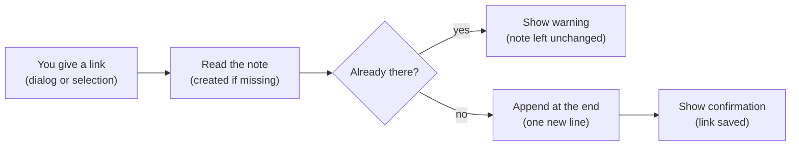

# Link Keeper — Obsidian plugin specification

## Overview

Link Keeper is an Obsidian plugin that adds a link to a note only if that note does not already contain it. If the link is already there, the plugin tells the user and changes nothing.

**Problem it solves:** when you collect links in one note (reading list, resources, bookmarks), it is easy to paste the same link twice. Checking by hand means searching the note every time.

**Scope:**

- One configurable target note collects links (default `Links.md`).
- The same check can run against the currently open note.
- Works with web links (`https://…`) and Obsidian note links (`[[Note]]`).
- Works on desktop and mobile Obsidian, version 1.4.0 or newer.

## How it works



Every add follows the same five steps:

1. The user runs a command and gives a link — typed, pasted, pre-filled from the clipboard, or selected in the editor.
2. The plugin picks the note: the target note from settings, or the open note for “Add link to current note”. If the note does not exist, it is created empty.
3. The plugin reads the whole note and looks for the link, using the duplicate rules below.
4. **Found:** a warning pop-up says the link is already there. The note is not touched.
5. **Not found:** one new line with the link is added at the end of the note, and a confirmation pop-up appears.

## Commands and entry points

The plugin has four commands (Command palette, Ctrl/Cmd+P) and a sidebar icon. Three commands and the icon start the add flow above; “Sort links in current note” puts the links of the open note in order (see “Sorting links” below). Each command can be given a hotkey in Settings → Hotkeys.

| Entry point | Where the link comes from | Note it checks and writes to | Available when |
| --- | --- | --- | --- |
| Add link to target note | Typed or pasted into a dialog | Target note from settings | Always |
| Add link to current note | Typed or pasted into a dialog | The note open right now | A Markdown note is open |
| Add selected link to target note | Text selected in the editor | Target note from settings | Text is selected |
| Sort links in current note | No link is given: it sorts the links already in the note | The note open in the editor | A Markdown note is open in the editor |
| Ribbon icon (link symbol) | Typed or pasted into a dialog | Target note from settings | Always |

**The dialog:**

- One text field with placeholder `https://… or [[Note]]` and an **Add** button.
- If “Pre-fill from clipboard” is on and the clipboard holds a web address, the field starts filled with it, text selected.
- Enter submits. Esc closes without doing anything.
- An empty field submits nothing.

## Duplicate detection rules

A link counts as a duplicate if it appears anywhere in the note — in a list, inside a sentence, in a Markdown link `[title](url)`, or in brackets. The check reads the whole note every time.

**Web links (input starts with `http://` or `https://`)**

Every web address in the note is found, then both sides are normalized before comparing:

1. `http` and `https` are treated as the same.
2. The domain is compared without capital letters, and a leading `www.` is ignored.
   The port must match (`:8080`); a default port (`:80`, `:443`) can be left out.
3. Trailing slashes on the path are ignored.
4. Punctuation stuck to the end in a sentence (`. , ; : ! ?`) is ignored.
5. The path, query (`?x=1`) and anchor (`#part`) must match exactly, including capital letters.

| Input | Already in the note | Result |
| --- | --- | --- |
| `https://example.com/page` | `https://www.Example.com/page/` | Duplicate |
| `http://example.com/page/` | `https://example.com/page` | Duplicate |
| `https://foo.dev/a?x=1` | `see (https://foo.dev/a?x=1).` | Duplicate |
| `https://foo.dev/a?x=2` | `https://foo.dev/a?x=1` | New, added |
| `https://example.com/Page` | `https://example.com/page` | New, added |
| `https://example.com:8080/page` | `https://example.com/page` | New, added |
| `https://en.wikipedia.org/wiki/Mercury_(planet)` | `[Mercury](https://en.wikipedia.org/wiki/Mercury_(planet))` | Duplicate |

**Anything else (`[[Note]]`, plain text)**

The note is searched for the exact text, ignoring capital letters. `[[My Note]]` is a duplicate of `[[my note]]`, but `[[My Note]]` and `[[My Note|alias]]` are different.

## Appending rules and notifications

A new link always goes on its own line at the very end of the note. Nothing else in the note moves or changes.

**How the line is written**

1. The line comes from the “Line format” setting, with `{link}` replaced by the link. Default: `- {link}` → `- https://example.com`. A format without `{link}` is ignored and the default is used, so the link is never lost.
2. If the note does not end with a line break, one is added first, so the link never joins the last line.
3. The new line ends with a line break, ready for the next link.
4. The link is written exactly as the user entered it — not normalized.
5. If the note is empty, the link becomes its first line.

**Messages shown to the user** (small pop-up in the top-right corner)

| Situation | Message | Shown for | Note changed? |
| --- | --- | --- | --- |
| Link is new | ✅ Added to “Links”: *link* | 4 seconds | Yes, one line added |
| Link already in the note | ⚠️ Already in “Links”: *link* | 6 seconds | No |
| Something failed | Link Keeper: could not add the link — see the developer console. | Default | No |

## Sorting links

“Sort links in current note” puts the link lines of the note open in the editor in order. It is a separate command: adding a link never sorts, and a new link still goes at the end of the note.

**Which lines move**

A link line is a line with a web address (`http://…`, `https://…`) or a note link (`[[…]]`). Only link lines move. Every other line keeps its exact place. The link lines fill the places where link lines were, in sorted order, so a link can move to another part of the note.

There are two kinds of link lines, and each kind is sorted apart:

- List-item link lines: the line starts with a list marker (`- `, `* `, `+ `, `1. `, `1) `), so a task (`- [ ]`) is one too. Spaces and tabs before the marker do not count.
- Plain link lines: all other link lines, like `Source: [[Note]]` or `https://example.com`.

List-item link lines only fill the places where list-item link lines were, and plain link lines only fill the places where plain link lines were. Both kinds use the same sort key and order. So a plain line never lands above a `---` line (where it would become an underlined heading) or right under a table (where it would become a table row), and the structure of the note does not change. A note with only list-item links (the default “Line format” `- {link}`) has one kind, so all its links sort together.

How each kind moves: each place keeps the start of its line, and only the rest of the line moves. The sort key comes from the part that moves.

- A list-item place keeps the spaces and tabs before the marker, the marker itself (`-`, `*`, `+`, `1.`, `1)`) and the spaces after it. The task box (`[ ]`, `[x]`), the link, its title and tags move together. So a numbered list keeps its numbers 1, 2, 3, a bullet list stays a bullet list, and each place keeps its indent, so the nesting of the list stays.
- A plain place keeps the spaces and tabs at the start of its line. The text before the link (like `Source:`), the link and the text after it move together. So an indented line inside a list item stays inside that item, and a link that moves to the left edge (under a heading, at the top of the note) never brings an indent that would turn it into a code block.

| Before | After |
| --- | --- |
| `1. [[Zen and the Art]]` | `1. [x] [[Atomic Habits]]` |
| `2. [x] [[Atomic Habits]]` | `2. [[Deep Work]]` |
| `   - [[Deep Work]]` | `   - [[Zen and the Art]]` |

| Before | After |
| --- | --- |
| `- Dune` | `- Dune` |
| `  https://example.com/dune` | `  https://a.com/alpha` |
| `## Articles` | `## Articles` |
| `https://a.com/alpha` | `https://example.com/dune` |

These lines never move, even when they hold a link:

- The frontmatter, as Obsidian reads it: the block at the very top that starts with a `---` line and ends at the next line that is exactly `---` (a `...` line does not end it). A `---` at the top with no closing `---` is a divider, not frontmatter, and so is a `---` line lower in the note.
- Fenced code blocks: from a line that starts with 3 or more `` ` `` or `~` (also right after one or more list markers, as in ```` - ``` ```` or ```` - 1. ``` ````) to a line with only the same character, at least as many. A code block opened after a list marker belongs to that item, so it also ends where the item ends: before the first line that is not blank and is indented less than the item's text. A line like ```` ```a``` text ```` is inline code, not the start of a code block.
- Comment blocks: an Obsidian comment from a line with an unpaired `%%` (a `%%` line, or a comment that starts after some text) to the next line with an unpaired `%%`; an HTML comment from a line where `<!--` starts and does not end to the next line with `-->` (a line like `--> <!--` ends the comment and opens a new one, so the block goes on). A comment that starts and ends in one line (`%%…%%`, `<!-- … -->`, also the empty `<!-->` and `<!--->`) is not a block.
- Tables: a line that has a divider line (like `--- | ---` or `|---|`) under it, and the rows after it, also rows without a `|` at the start. The first line needs no `|`: `Links` over `|---|` is a table with one column. So a moved link with `|` in it (`[[Note|alias]]`) never lands above a divider and turns the two lines into a table. A table ends before the first blank line, the first divider line (`---`, `***`, `___`) or the first line that starts another block: a list item (`- `, `1. `), a heading, a quote or callout, a code block or a comment (also a one-line `<!-- … -->`).
- Headings (`#` to `######`, then a space, a tab or the line end), table rows (start with `|`), quotes and callouts (start with `>`). A `#tag` line is not a heading, so its link moves. Lines that start with an HTML comment (`<!-- note --> https://…`) stay too: such a line ends a table or an underlined heading above it, and a link moved into its place would not.
- Underlined headings: one or more lines of plain text with a `===` or `---` line right under them, also inside a list item, where the underline is indented like the item's text. A numbered line that does not start at 1 (`2. …`) is part of the text when it goes on with a text line right above it, or with the text of a list item it is indented into, as in Markdown; under a blank line or as the next item of a numbered list (`1. …`, then `2. …`) it is a list item. A list item is part of the heading when the underline is indented at least as far as the item's text (so the underline is inside the item). A line indented 4 or more columns past where the heading text starts is part of that text, also when it looks like `# …`, `- …` or `> …` (an indented code block cannot break a paragraph). As in Markdown, the underline may be indented at most 3 columns past where the heading text starts (the item's text, or else the first text line); indented 4 or more, it is plain text and the line above it is no heading. A `---` under a blank line, a table, a one-line comment, or a list item whose text starts further right is a divider, not an underline, so the link above it moves.
- Footnote definitions (`[^1]: https://…`) and link reference definitions (`[a]: https://…`): lines that start with `[label]:`. So a footnote never moves into the body, and a body link never takes the place of a footnote.

A code block or comment block that is never closed runs to the end of the note. Spaces and tabs at the start of a line are ignored for the code block, heading, table row, quote and definition checks.

The sort does not remove duplicates and does not change the text that moves; it only puts it in another place. Each place keeps its own line break, so Windows line breaks (CRLF) and a missing line break at the end stay as they were.

**Sort key**

Each link line is sorted by the last part of its first link (the link that starts first in the line):

- Web link: the text after the last `/`, without the query (`?…`), the anchor (`#…`), slashes at the end and punctuation stuck to the end (`. , ; : ! ?`), and Markdown bold, italic or strike-through marks glued to a bare link (`**https://…**`, `_…_`, `~~…~~`). `%` codes are turned back into letters; a broken one (`100%`) is kept as it is. A link with no path is sorted by its domain, `www.` included. In a Markdown link (`[title](address)`) the address counts, also when the title is a web address itself (`[https://b.com/zeta](https://a.com/alpha)` is sorted by `alpha`).
- Note link: the note name, without folder and alias. A link to a heading in the same note (`[[#Heading]]`) is sorted by the whole heading text, also when it holds a `/`.

| Line | Sorted by |
| --- | --- |
| `- https://a.com/docs/page?id=2` | `page` |
| `- https://a.com/docs/` | `docs` |
| `- https://www.a.com/` | `www.a.com` |
| `- [Zebra](https://c.com/blog/Alpha)` | `Alpha` |
| `- https://en.wikipedia.org/wiki/Mercury_(planet)` | `Mercury_(planet)` |
| `- https://ru.wikipedia.org/wiki/%D0%9C%D0%BE%D1%81%D0%BA%D0%B2%D0%B0` | `Москва` |
| `- [[Folder/My Note\|alias]]` | `My Note` |
| `- [[Note#Heading]]` | `Note` |
| `- [[#Heading]]` | `Heading` |
| `- [[Other]] https://a.com/x` | `Other` |

**Order**

Punctuation first, then digits, then letters. Numbers are compared by value, so `2-tips` comes before `10-tips`. Capital letters and accents do not count (`alpha` = `Alpha`, `éclair` = `eclair`). Other scripts, like Cyrillic, come after Latin letters. Lines with the same key keep their old order, so sorting a second time changes nothing.

| Before | After |
| --- | --- |
| `# Reading` | `# Reading` |
| `- https://b.com/zeta` | `- https://a.com/2-intro` |
| `Some text` | `Some text` |
| `- https://a.com/2-intro` | `- [Alpha](https://c.com/docs/alpha/)` |
| `- [Alpha](https://c.com/docs/alpha/)` | `- https://b.com/zeta` |

**Writing and messages**

The command changes only the lines that change, in one step through the open editor (Obsidian saves it as usual), so Ctrl/Cmd+Z undoes the whole sort at once and the rest of the note (folded sections) is not touched. The sort is its own undo step: Ctrl/Cmd+Z right after it undoes only the sort, not typing done just before it. It writes only when the order changes. The cursor stays on the same line number; that line may now hold another link, and when that line is shorter the cursor goes to its end. A selection is not kept: only the cursor comes back. After the sort the editor scrolls to the cursor, as Obsidian does for every editor change.

| Situation | Message | Shown for | Note changed? |
| --- | --- | --- | --- |
| Lines moved | ✅ Sorted *n* links in “*note*” | 4 seconds | Yes, only the order of the links |
| Already in order, or 0–1 link lines | Links in “*note*” are already in order | 4 seconds | No |
| Something failed | Link Keeper: could not sort the links — see the developer console. | Default | No |

*n* is the number of link lines in the note (both kinds), also the ones that did not move. *note* is the note name without `.md`.

**Known limits** (not fixed)

- A link line inside a paragraph that is wrapped over several lines moves alone: the paragraph is split, and another link line can land in the middle of the sentence. Put a blank line before and after links that should be sorted.
- Each link moves alone. A line under a link (a sub-item or a note) does not follow it. Each place keeps its indent, so the shape of the note stays, but a link from a sub-item or from an indented line inside a list item can move to a top place and the other way round.
- Indented code blocks (4 spaces, no fence) are not found: the text of a link line inside one can move out, and another link can move in and show as code.
- A link inside inline code (`` `https://…` ``) still counts as a link line.
- Embeds count as links: `![[image.png]]` and `` lines move like links.
- A single `%%` anywhere in a line starts or ends a comment block: also inside inline code (`` `%%` ``), inside a link, in plain text like `100%%`, or inside the other kind of comment (`<!-- %% -->`). The same goes for `<!--`. The lines below it do not move until the next unpaired `%%` or `-->`, and the pop-up can say the links are already in order.
- Math blocks (`$$`) and HTML blocks (like `<div>`) are not found; a link line inside one can move.
- A line with only fence characters ends a code block even when it is indented by 4 or more spaces, where Markdown can still count it as code.
- In Markdown, a text line right under a quote or callout, without `>` at its start, can still belong to it. Here it is a normal line, so its link can move.
- In the same way, a text line right under a footnote definition (`[^1]: …`) can still belong to the footnote. Here it is a normal line, so its link can move out of the footnote and another plain link line can move in.
- Markdown links to notes (`[Alpha](Alpha.md)`, used when “Use [[Wikilinks]]” is off) are not link lines: they stay in place while the other links are sorted around them.
- The command works only in the editor (editing view). Obsidian hides it in reading view and while you type in the note’s properties.

## Settings

Three settings live under Settings → Link Keeper. Changes save immediately and apply to the next link.

| Setting | Type | Default | What it does |
| --- | --- | --- | --- |
| Target note | Text (path in vault) | `Links.md` | Note that collects links. Folders allowed, e.g. `Inbox/Links.md`. `.md` is added if missing. An empty value falls back to the default. |
| Line format | Text | `- {link}` | Template for each new line. Examples: `{link}`, `- [ ] {link}`, `* {link} #toread`. |
| Pre-fill from clipboard | On / off | On | Fills the dialog with the clipboard content when it is a web address. |

## Edge cases and error handling

| Case | Expected behavior |
| --- | --- |
| Target note does not exist | It is created (and its folder, if needed), then the link is added. |
| Same link entered twice quickly | Read-check-write happens in one step, so the second attempt sees the first and reports a duplicate. |
| Note is open and being edited | The link is still appended safely; the open editor shows the new line. |
| Link has spaces before or after | Spaces are trimmed before checking and writing. |
| Input is empty | Nothing happens. |
| Clipboard cannot be read (permission, mobile) | Dialog opens empty; no error is shown. |
| “Add link to current note” with no note open | Command is hidden in the palette. |
| “Add link to current note” with a canvas, PDF or image open | Command is hidden in the palette; only Markdown notes are changed. |
| “Add selected link” with nothing selected | Command is hidden in the palette. |
| Selection holds several links | Whole selection is treated as one entry. |
| Writing the file fails | Error message shown, note unchanged, details logged to the developer console. |

## Technical notes and installation

**Files:** the plugin is two files in `.obsidian/plugins/link-keeper/` — `manifest.json` (id `link-keeper`, version 0.1, minimum Obsidian 1.5.0) and `main.js`. Settings are stored by Obsidian in `data.json` in the same folder.

**Source and build:** the code is TypeScript in `src/` (`links.ts` holds the duplicate and line rules with no Obsidian imports, so it is tested on its own). `make build` type-checks it, bundles it into `plugin/main.js` with Deno (no Node or npm) and copies `manifest.json` next to it. `make test` runs the tests in `tests/`. The `plugin/` folder is build output and is not kept in git.

**Releases:** GitHub Actions runs lint, build and tests on every push to `main` and every pull request; it does not publish releases. A release is made by hand: `scripts/release.sh <tag>` checks that the tag is the `version` in `manifest.json`, that the local Deno is the version CI uses, that `origin` is a GitHub repository (an https or SSH URL, an SSH host alias that points at github.com, or an `insteadOf` short name), that `gh` can see that repository, that the checked-out commit is the tag, that there are no uncommitted or untracked files, that the tag on GitHub is the same commit and that `gh` can reach the release (a missing release is fine). All `gh` calls go to the `origin` repository. Then it runs `make test zip` and uploads `main.js`, `manifest.json` and `link-keeper.zip` (unzips to `link-keeper/`) to the GitHub release for that tag. A failed check or test stops it before anything is published. If the tag already has a release, its three files are replaced (and its notes, when `docs/releases/<tag>.md` exists); the release is not deleted first, so a failed upload can be finished by running the script again. The tag stays.

**Key implementation choices:**

- The check and the write use Obsidian’s `vault.process`, which reads and saves the note in one step, so nothing is lost if the note changes at the same moment.
- Web addresses are found with a pattern match on `http(s)://` up to the next space, quote or bracket. One pair of round brackets inside the address is kept, so `…/Mercury_(planet)` stays whole.
- No network access, no data leaves the vault.

**Installation:**

1. Download `link-keeper.zip` from a GitHub release and unzip it into the vault’s `.obsidian/plugins/` folder. Or run `make build` and copy the two files from `plugin/` (`main.js`, `manifest.json`) into the vault’s `.obsidian/plugins/link-keeper/` folder.
2. Open Settings → Community plugins, turn off Restricted mode if needed, and enable Link Keeper.
3. Optionally set the target note and a hotkey.
