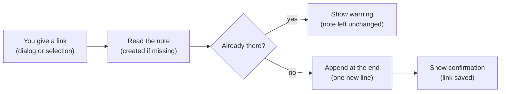

# Link Keeper — Obsidian plugin specification

## Overview

Link Keeper is an Obsidian plugin that adds a link to a note only if that note does not already contain it. If the link is already there, the plugin tells the user and changes nothing.

**Problem it solves:** when you collect links in one note (reading list, resources, bookmarks), it is easy to paste the same link twice. Checking by hand means searching the note every time.

**Scope:**

- One configurable target note collects links (default `Links.md`).
- The same check can run against the currently open note.
- Works with web links (`https://…`) and Obsidian note links (`[[Note]]`).
- Works on desktop and mobile Obsidian, version 1.4.0 or newer.

## How it works

Every add follows the same five steps:

1. The user runs a command and gives a link — typed, pasted, pre-filled from the clipboard, or selected in the editor.
2. The plugin picks the note: the target note from settings, or the open note for “Add link to current note”. If the note does not exist, it is created empty.
3. The plugin reads the whole note and looks for the link, using the duplicate rules below.
4. **Found:** a warning pop-up says the link is already there. The note is not touched.
5. **Not found:** one new line with the link is added at the end of the note, and a confirmation pop-up appears.

## Commands and entry points

The user starts the flow from one of three commands (Command palette, Ctrl/Cmd+P) or from a sidebar icon. Each command can be given a hotkey in Settings → Hotkeys.

| Entry point | Where the link comes from | Note it checks and writes to | Available when |
| --- | --- | --- | --- |
| Add link to target note | Typed or pasted into a dialog | Target note from settings | Always |
| Add link to current note | Typed or pasted into a dialog | The note open right now | A Markdown note is open |
| Add selected link to target note | Text selected in the editor | Target note from settings | Text is selected |
| Ribbon icon (link symbol) | Typed or pasted into a dialog | Target note from settings | Always |

**The dialog:**

- One text field with placeholder `https://… or [[Note]]` and an **Add** button.
- If “Pre-fill from clipboard” is on and the clipboard holds a web address, the field starts filled with it, text selected.
- Enter submits. Esc closes without doing anything.
- An empty field submits nothing.

## Duplicate detection rules

A link counts as a duplicate if it appears anywhere in the note — in a list, inside a sentence, in a Markdown link `[title](url)`, or in brackets. The check reads the whole note every time.

**Web links (input starts with `http://` or `https://`)**

Every web address in the note is found, then both sides are normalized before comparing:

1. `http` and `https` are treated as the same.
2. The domain is compared without capital letters, and a leading `www.` is ignored.
   The port must match (`:8080`); a default port (`:80`, `:443`) can be left out.
3. Trailing slashes on the path are ignored.
4. Punctuation stuck to the end in a sentence (`. , ; : ! ?`) is ignored.
5. The path, query (`?x=1`) and anchor (`#part`) must match exactly, including capital letters.

| Input | Already in the note | Result |
| --- | --- | --- |
| `https://example.com/page` | `https://www.Example.com/page/` | Duplicate |
| `http://example.com/page/` | `https://example.com/page` | Duplicate |
| `https://foo.dev/a?x=1` | `see (https://foo.dev/a?x=1).` | Duplicate |
| `https://foo.dev/a?x=2` | `https://foo.dev/a?x=1` | New, added |
| `https://example.com/Page` | `https://example.com/page` | New, added |
| `https://example.com:8080/page` | `https://example.com/page` | New, added |
| `https://en.wikipedia.org/wiki/Mercury_(planet)` | `[Mercury](https://en.wikipedia.org/wiki/Mercury_(planet))` | Duplicate |

**Anything else (`[[Note]]`, plain text)**

The note is searched for the exact text, ignoring capital letters. `[[My Note]]` is a duplicate of `[[my note]]`, but `[[My Note]]` and `[[My Note|alias]]` are different.

## Appending rules and notifications

A new link always goes on its own line at the very end of the note. Nothing else in the note moves or changes.

**How the line is written**

1. The line comes from the “Line format” setting, with `{link}` replaced by the link. Default: `- {link}` → `- https://example.com`. A format without `{link}` is ignored and the default is used, so the link is never lost.
2. If the note does not end with a line break, one is added first, so the link never joins the last line.
3. The new line ends with a line break, ready for the next link.
4. The link is written exactly as the user entered it — not normalized.
5. If the note is empty, the link becomes its first line.

**Messages shown to the user** (small pop-up in the top-right corner)

| Situation | Message | Shown for | Note changed? |
| --- | --- | --- | --- |
| Link is new | ✅ Added to “Links”: *link* | 4 seconds | Yes, one line added |
| Link already in the note | ⚠️ Already in “Links”: *link* | 6 seconds | No |
| Something failed | Link Keeper: could not add the link — see the developer console. | Default | No |

## Settings

Three settings live under Settings → Link Keeper. Changes save immediately and apply to the next link.

| Setting | Type | Default | What it does |
| --- | --- | --- | --- |
| Target note | Text (path in vault) | `Links.md` | Note that collects links. Folders allowed, e.g. `Inbox/Links.md`. `.md` is added if missing. An empty value falls back to the default. |
| Line format | Text | `- {link}` | Template for each new line. Examples: `{link}`, `- [ ] {link}`, `* {link} #toread`. |
| Pre-fill from clipboard | On / off | On | Fills the dialog with the clipboard content when it is a web address. |

## Edge cases and error handling

| Case | Expected behavior |
| --- | --- |
| Target note does not exist | It is created (and its folder, if needed), then the link is added. |
| Same link entered twice quickly | Read-check-write happens in one step, so the second attempt sees the first and reports a duplicate. |
| Note is open and being edited | The link is still appended safely; the open editor shows the new line. |
| Link has spaces before or after | Spaces are trimmed before checking and writing. |
| Input is empty | Nothing happens. |
| Clipboard cannot be read (permission, mobile) | Dialog opens empty; no error is shown. |
| “Add link to current note” with no note open | Command is hidden in the palette. |
| “Add link to current note” with a canvas, PDF or image open | Command is hidden in the palette; only Markdown notes are changed. |
| “Add selected link” with nothing selected | Command is hidden in the palette. |
| Selection holds several links | Whole selection is treated as one entry. |
| Writing the file fails | Error message shown, note unchanged, details logged to the developer console. |

## Technical notes and installation

**Files:** the plugin is two files in `.obsidian/plugins/link-keeper/` — `manifest.json` (id `link-keeper`, version 0.1, minimum Obsidian 1.5.0) and `main.js`. Settings are stored by Obsidian in `data.json` in the same folder.

**Source and build:** the code is TypeScript in `src/` (`links.ts` holds the duplicate and line rules with no Obsidian imports, so it is tested on its own). `make build` type-checks it, bundles it into `plugin/main.js` with Deno (no Node or npm) and copies `manifest.json` next to it. `make test` runs the tests in `tests/`. The `plugin/` folder is build output and is not kept in git.

**Releases:** GitHub Actions runs the tests on every push. Pushing a git tag also publishes a GitHub release for that tag with `main.js`, `manifest.json` and `link-keeper.zip` (unzips to `link-keeper/`), only when the tests pass. If the tag already has a release, it is rewritten with the new files; the tag stays.

**Key implementation choices:**

- The check and the write use Obsidian’s `vault.process`, which reads and saves the note in one step, so nothing is lost if the note changes at the same moment.
- Web addresses are found with a pattern match on `http(s)://` up to the next space, quote or bracket. One pair of round brackets inside the address is kept, so `…/Mercury_(planet)` stays whole.
- No network access, no data leaves the vault.

**Installation:**

1. Download `link-keeper.zip` from a GitHub release and unzip it into the vault’s `.obsidian/plugins/` folder. Or run `make build` and copy the two files from `plugin/` (`main.js`, `manifest.json`) into the vault’s `.obsidian/plugins/link-keeper/` folder.
2. Open Settings → Community plugins, turn off Restricted mode if needed, and enable Link Keeper.
3. Optionally set the target note and a hotkey.
